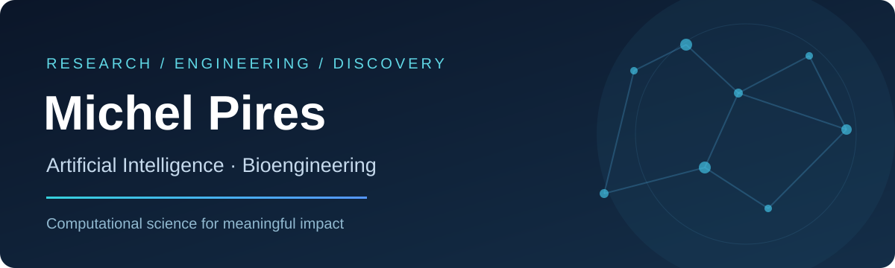
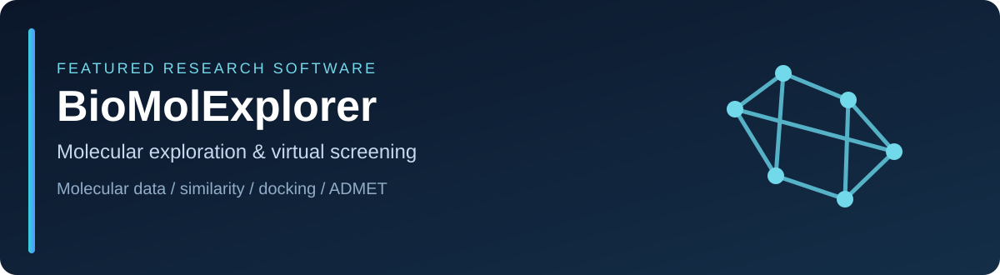

 

**University Professor · Researcher · Scientific Software Developer**

*Building intelligent, reproducible computational methods at the intersection of computer science and life sciences.*

 

## ◈ Research at a glance

<table>
<tr>
<td width="33%" align="center"><h3>🧠 Artificial Intelligence</h3>Machine Learning · Deep Learning · Predictive Modeling</td>
<td width="33%" align="center"><h3>🧬 Bioengineering</h3>Bioinformatics · Cheminformatics · Molecular Modeling</td>
<td width="33%" align="center"><h3>⚗️ Drug Discovery</h3>Virtual Screening · Molecular Docking · Computational Pipelines</td>
</tr>
</table>

I am a professor and researcher at the **Federal Center for Technological Education of Minas Gerais (CEFET-MG)**, Brazil. My work focuses on applying artificial intelligence and computational methods to problems in bioengineering, computational molecular science, and scientific software development.

---

## ◈ Featured projects

An integrated environment for molecular data exploration and computer-aided drug discovery, encompassing molecular retrieval, similarity analysis, molecular networks, consensus docking, and ADMET-related analysis.

 

A deep learning framework for **high-throughput docking score prediction**. NeuroDock uses molecular fingerprints and neural networks to predict scores derived from a consensus docking strategy involving AutoDock Vina and DOCK6, supporting scalable compound prioritization. Research applications include therapeutic targets associated with Alzheimer's disease.

<!-- NEURODOCK: Add the official repository or publication URL here when publicly available. -->

---

## ◈ Research & technology

<table>
<tr><td width="50%" valign="top"><b>🔬 Computational research</b>  Molecular fingerprints, consensus docking, predictive models, biological and chemical data analysis.</td><td width="50%" valign="top"><b>🛠️ Scientific engineering</b>  Reproducible workflows, automation, scientific software, data-driven tools and research accessibility.</td></tr>
</table>

## ◈ Academic collaborations

I welcome research collaborations involving **AI for science**, **computational drug discovery**, **bioinformatics**, and **reproducible scientific software**. For publications, institutional details, and academic background, see my [Lattes CV](http://lattes.cnpq.br/1449902596670082) or [institutional profile](http://www.somos.cefetmg.br/professores/view/2818).

---

Computer Science × Artificial Intelligence × Bioengineering 
Designed for clarity, scientific impact, and collaboration.

