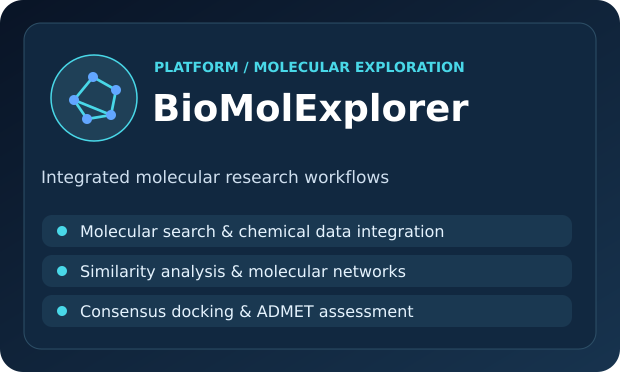
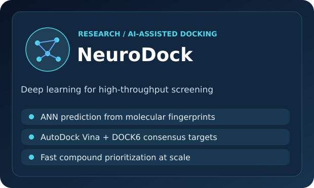
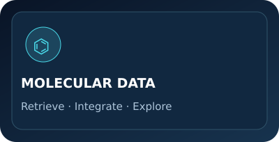
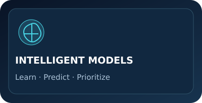
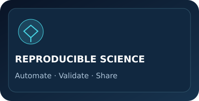

 

**Artificial Intelligence · Bioinformatics · Computational Drug Discovery**

*Transforming complex computational methods into accessible, reproducible tools for scientific discovery.*

## About

I am a **university professor and researcher at CEFET-MG, Brazil**, working at the intersection of computer science, artificial intelligence, and bioengineering. My interests include high-throughput virtual screening, molecular modeling, cheminformatics, graph analytics, and scientific software engineering.

## Featured scientific projects

<table>
<tr>
<td width="50%" valign="top">

 
<b>BioMolExplorer</b> is an integrated environment for exploring molecular information and supporting computer-aided drug discovery.
  

</td>
<td width="50%" valign="top">

 
<b>NeuroDock</b> is a deep learning framework for high-throughput prediction of consensus docking scores, combining molecular fingerprints and neural networks to accelerate compound prioritization.
  

<!-- Add a verified NeuroDock source-code or article URL when publicly available. -->
</td>
</tr>
</table>

## What I build

<table>
<tr>
<td width="33%" valign="top" align="center"></td>
<td width="33%" valign="top" align="center"></td>
<td width="33%" valign="top" align="center"></td>
</tr>
</table>

## Research ecosystem

<table>
<tr>
<td width="50%" valign="top">

### 🔬 Research

**AI for scientific discovery** — machine learning and deep learning for predictive modeling and molecular investigation.

**Structure-based drug discovery** — virtual screening, consensus docking, and prioritization of candidate compounds.

</td>
<td width="50%" valign="top">

### 🛠 Engineering

**Scientific software** — accessible computational workflows integrating heterogeneous scientific tools and datasets.

**Data & graphs** — exploration of relational structure, chemical similarity, and complex network patterns.

</td>
</tr>
</table>

## Connect & collaborate

Open to academic collaborations in **AI for science, computational molecular research, and research software**. Explore my [Lattes](http://lattes.cnpq.br/1449902596670082), [institutional profile](https://sig.cefetmg.br/sigaa/public/docente/portal.jsf?siape=2147282), or [LinkedIn](https://www.linkedin.com/in/michelpiressilva/).

---

MICHEL PIRES  /  COMPUTER SCIENCE × ARTIFICIAL INTELLIGENCE × BIOENGINEERING

